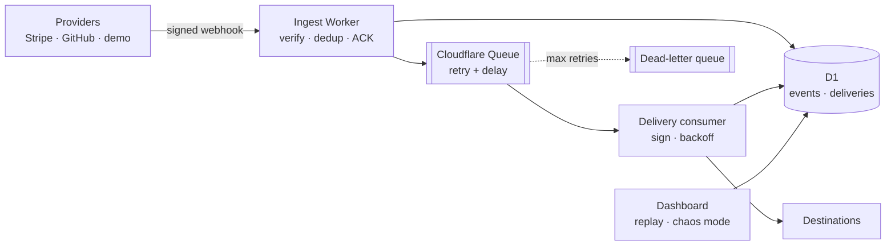

# HookRelay

**Reliable webhook ingestion and delivery gateway, running on Cloudflare Workers.**

[](https://github.com/amaury-molina/hookrelay/actions/workflows/ci.yml)


Live: **https://hookrelay.amauryalejandrom.workers.dev/health**

## The problem

Every team that consumes webhooks from Stripe, GitHub or Shopify ends up
rebuilding the same fragile plumbing. Events get lost during deploys, arrive
twice or out of order, and are processed without verifying who sent them.

HookRelay sits between webhook providers and your services. It verifies every
signature, persists the event before acknowledging it, and delivers it to one
or more destinations with retries, a dead-letter queue and replay.

## Architecture (target)



Design decisions are recorded in [`docs/adr`](docs/adr). The phased plan is in
[`docs/roadmap.md`](docs/roadmap.md).

## API (phase 0)

| Method | Path | Description |
| --- | --- | --- |
| `GET` | `/health` | Liveness and deployed version (git SHA) |
| `POST` | `/in/{source}` | Accepts a webhook from `stripe`, `github` or `demo`; returns `202` |

Errors follow [RFC 9457](https://www.rfc-editor.org/rfc/rfc9457) (`application/problem+json`),
and every response carries an `X-Request-Id`.

```bash
curl -s https://hookrelay.amauryalejandrom.workers.dev/health

curl -s -X POST https://hookrelay.amauryalejandrom.workers.dev/in/demo \
  -H 'content-type: application/json' \
  -d '{"type":"demo.ping"}'
```

## Develop in the browser

This project needs no local installs. Everything runs in GitHub Codespaces and
GitHub Actions.

1. **Code → Codespaces → Create codespace on main.** Dependencies install automatically.
2. Run the checks:
   ```bash
   npm run check     # lint + typecheck + tests (inside workerd)
   ```
3. Run the Worker locally inside the codespace:
   ```bash
   npm run dev       # forwards port 8787
   ```

### Deploying

Merging to `main` runs the pipeline: lint, typecheck and tests, then
`wrangler deploy` and a smoke test that checks `/health` reports the new commit.

Required repository configuration (**Settings → Secrets and variables → Actions**):

| Name | Kind | Purpose |
| --- | --- | --- |
| `CLOUDFLARE_API_TOKEN` | Secret | Token scoped to Workers Scripts, D1 and Queues |
| `CLOUDFLARE_ACCOUNT_ID` | Variable | Target Cloudflare account |

Webhook signing secrets are set with `wrangler secret put` and are never committed.

## Tech stack

TypeScript · Hono · Cloudflare Workers · Cloudflare Queues · D1 · Vitest (Workers integration) ·
Biome · GitHub Actions

## License

[MIT](LICENSE) © Amaury Molina
